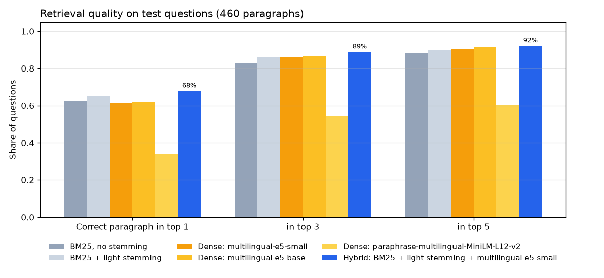
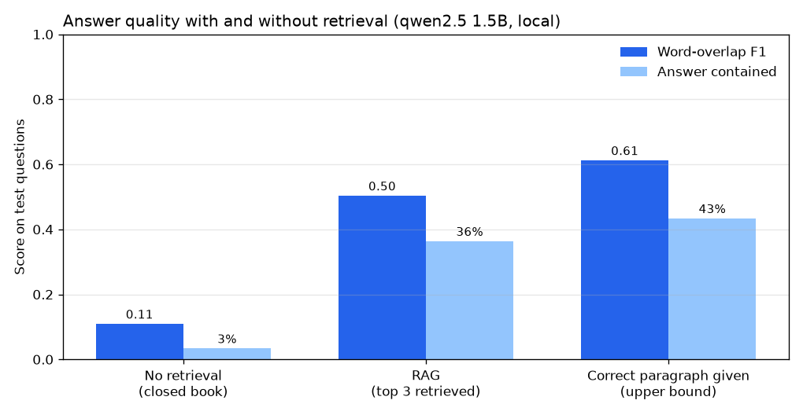

# Arabic RAG Assistant

A question-answering assistant for Arabic. It searches a collection of Arabic Wikipedia paragraphs, hands the most relevant ones to a small local language model, and returns a short answer together with its sources. Everything runs on a laptop CPU, with no paid API.

**Results:**
- **Retrieval:** the right paragraph is in the top 3 for **89%** of test questions. That's a hybrid of keyword and embedding search, chosen on separate dev questions.
- **Answers:** retrieval multiplies answer quality. Word-overlap F1 goes from **0.11** without retrieval to **0.50** with it, and to 0.61 when the model is handed the correct paragraph.
- **Manual review:** **54%** of 50 random answers were correct. That rises to **67.5%** when retrieval found the right paragraph, and drops to **0%** when it didn't.
- **Runs offline** on a laptop CPU, taking about 13 seconds per question.

```text
Question: ما الجائزة التي حصل عليها نجيب محفوظ؟
Answer:   جائزة نوبل في الأدب.
Sources:  [1] نجيب محفوظ  [2] نجيب محفوظ  [3] نجيب محفوظ
```

## How it works

```
question ──► retrieval (BM25 + embeddings, fused) ──► top 3 paragraphs ──► qwen2.5 1.5B (local, Ollama) ──► answer + sources
```

1. **Retrieval:** a hybrid of keyword search (BM25 with Arabic normalization and light stemming) and semantic search (multilingual-e5-small embeddings), combined with reciprocal rank fusion.
2. **Generation:** the question and the top 3 paragraphs go to `qwen2.5:1.5b` running locally through [Ollama](https://ollama.com). The prompt tells the model to answer only from the paragraphs, and to say "لا أعرف" when the answer isn't there.
3. **Sources:** every answer comes back with the paragraphs it was based on, so it can be checked.

## Data

[ARCD](https://huggingface.co/datasets/hsseinmz/arcd) (Arabic Reading Comprehension Dataset, MIT license): crowd-written questions about Arabic Wikipedia articles, with answer spans.

- **460 paragraphs** from 146 articles form the searchable collection.
- **1,388 questions** (7 duplicates removed), each linked to the paragraph that answers it.
- ARCD's train split (691 questions) is used as a **dev set** to choose the retrieval method. Its validation split (697 questions) is the **test set**, used only to confirm the final numbers.

Two things about the data affect the results:
- **Many questions depend on their paragraph.** "بماذا اشتهر؟" ("what was he known for?") doesn't say who "he" is, because the person writing it was looking at the paragraph.
- **Some reference answers are wrong or oddly cut.** For example, the reference answer to "متى ولد توماس ألفا أديسون؟" is "ألفا", which is part of his name and not a date, and several answers include stray brackets. This drags automatic scores down even when the model is right, which is why the answers are also checked by hand (see below).

## Retrieval

Each method is scored on whether the correct paragraph appears among its top results.

| Method | Dev: top 3 | Test: top 1 | Test: top 3 | Test: top 5 | Test MRR@10 |
|---|---|---|---|---|---|
| BM25, no stemming | 83.2% | 62.7% | 82.9% | 88.0% | 0.735 |
| BM25 + Arabic light stemming | 87.0% | 65.3% | 85.9% | 89.7% | 0.761 |
| Dense: multilingual-e5-small | 88.9% | 61.1% | 85.8% | 90.2% | 0.739 |
| Dense: multilingual-e5-base | 88.1% | 62.0% | 86.5% | 91.5% | 0.748 |
| Dense: paraphrase-multilingual-MiniLM | 55.4% | 33.9% | 54.5% | 60.4% | 0.455 |
| **Hybrid: BM25 + stemming + e5-small** | **91.5%** | **68.0%** | **89.0%** | **92.3%** | **0.784** |



- **The hybrid is the best method, and it was chosen on dev questions only.** Keyword search and embeddings make different mistakes, so fusing them helps: 89% of test questions get their paragraph in the top 3.
- **Light stemming helps keyword search.** It removes the article and attached prepositions (والمدينة → مدينه), raising top-1 from 62.7% to 65.3%.
- **The larger e5-base model isn't better than e5-small here**, even though it's more than twice the size (278M vs 118M parameters).
- **The paraphrase model is weak (54.5%).** It was trained to match sentences with similar meaning, not questions with the paragraphs that answer them.

**Why retrieval misses** ([`src/analyze_misses.py`](src/analyze_misses.py)):

| Test questions | Count | Correct paragraph in top 3 |
|---|---|---|
| Name their subject (e.g. "ما الجائزة التي حصل عليها نجيب محفوظ؟") | 444 | **95.7%** |
| Don't name it (e.g. "بماذا اشتهر؟") | 253 | 77.1% |
| Two content words or fewer | 85 | 67.1% |

Most misses come from questions that don't contain enough information on their own, not from weak search. In a real chat assistant, the fix is to rewrite each question using the conversation so far before searching.

**Overlapping paragraphs.** 76 paragraphs (16.5%) are fully contained in a longer paragraph from the same article, so returning the longer version counts as a miss above. With a more lenient metric, "the answer text appears in the retrieved paragraphs", the hybrid reaches 74.3% at top 1 and 89.5% at top 3. The ranking of the methods doesn't change.

## Answers

The same model answered the same 300 random test questions in three settings:

| Setting | Exact match | Word-overlap F1 | Answer contained | Says "لا أعرف" |
|---|---|---|---|---|
| No retrieval (closed book) | 0.3% | 0.11 | 3.3% | 0% |
| **RAG: top 3 retrieved paragraphs** | **23.0%** | **0.50** | **36.3%** | 0.3% |
| Correct paragraph given (upper bound) | 29.3% | 0.61 | 43.3% | 0.7% |



| RAG answers, split by retrieval | Questions | F1 | Answer contained |
|---|---|---|---|
| Retrieval found the right paragraph | 255 | 0.58 | 41.2% |
| Retrieval missed it | 45 | 0.08 | 8.9% |

- **Without retrieval, the model almost never knows, and it never admits it.** It answered every question, with an F1 of 0.11. A 1.5B model hasn't memorized Arabic Wikipedia.
- **Retrieval is the bottleneck.** When the right paragraph is retrieved, answers are close to the upper bound. When it isn't, they are almost always wrong.

**Manual review.** Automatic scores undercount, because the model rephrases correct answers and some reference answers are wrong. So 50 random RAG answers were read against their paragraphs ([`reports/manual_review.json`](reports/manual_review.json)):

| | Correct | Partly correct | Wrong |
|---|---|---|---|
| All 50 answers | **27 (54%)** | 2 | 21 |
| Retrieval found the right paragraph (40) | **27 (67.5%)** | 2 | 11 |
| Retrieval missed (10) | 0 | 0 | 10 |

When the paragraph was there, the mistakes were:
- misreading it, for example the wrong neighboring countries;
- **drifting out of Arabic**: one answer came out in Chinese characters, and "من رسم الموناليزا؟" was answered "Leonardo da Vinci" in English;
- an unhelpful answer that repeated the question.

**Known weakness: questions outside the collection.** Asked "ما هي عاصمة البرازيل؟", which no paragraph covers, the retriever returned unrelated paragraphs (about Ronaldo and Morocco). The model answered from memory instead of saying "لا أعرف", and got it wrong ("رويو دي جانيرو"; the capital is Brasília). The prompt alone doesn't stop a small model from guessing.

**Speed.** Answering takes about 13 seconds per question (median of 20, `/ask` end to end on a laptop CPU), mostly the model reading the three paragraphs. Without paragraphs, the model answers in 1.5 seconds.

## API

```bash
uvicorn app.main:app
# open http://127.0.0.1:8000 for the web page, http://127.0.0.1:8000/docs for the API docs
```

| Endpoint | Description |
|---|---|
| `GET /` | Web page in Arabic (right-to-left) with example questions |
| `POST /ask` | `{"question": "..."}` → answer plus the 3 source paragraphs |
| `GET /search?q=...&k=3` | Retrieval only, no language model needed |
| `GET /health` | Whether the retriever is loaded and the language model is reachable |

```bash
curl -X POST http://127.0.0.1:8000/ask -H "Content-Type: application/json" -d '{"question": "ما الجائزة التي حصل عليها نجيب محفوظ؟"}'
```

```json
{
  "answer": "جائزة نوبل في الأدب.",
  "sources": [
    {"passage_id": 66, "title": "نجيب محفوظ", "text": "نجيب محفوظ (11 ديسمبر 1911 - 30 أغسطس 2006) روائي مصري، هو أ...", "score": 0.0325},
    {"passage_id": 67, "title": "نجيب محفوظ", "text": "...", "score": 0.0325},
    {"passage_id": 443, "title": "نجيب محفوظ", "text": "...", "score": 0.0317}
  ]
}
```

If the language model server isn't running, `/ask` returns `503` instead of crashing. A question shorter than 3 characters returns `422`.

## Run it

```bash
# 1. Local language model
#    Install Ollama from https://ollama.com, then:
ollama pull qwen2.5:1.5b

# 2. Python environment
python -m venv .venv
.venv\Scripts\activate          # on macOS/Linux: source .venv/bin/activate
pip install -r requirements.txt

# 3. Evaluate and serve
python src/eval_retrieval.py    # compares retrieval methods (downloads data and embedding models)
python src/analyze_misses.py    # why retrieval misses, overlapping paragraphs
python src/eval_generation.py   # answer quality on 300 test questions (about 75 minutes on CPU)
uvicorn app.main:app

pytest                          # 11 tests; the language model is stubbed, so Ollama isn't needed
```

## Project structure

```
src/
  data.py              ARCD loading: paragraphs, questions, dev/test split
  text.py              Arabic normalization, stopwords, light stemming
  retrieval.py         BM25, dense, and hybrid retrievers; recall and MRR
  llm.py               client for the local Ollama server
  rag.py               prompts and the retrieve-then-answer pipeline
  metrics.py           exact match, F1, contains-answer, "I don't know" detection
  eval_retrieval.py    retrieval comparison (dev for choosing, test for confirming)
  analyze_misses.py    retrieval failure analysis
  eval_generation.py   closed book vs RAG vs correct-paragraph answers
app/
  main.py              FastAPI service
  static/index.html    Arabic web page
tests/                 text, metrics, and API tests
reports/               results (JSON), every generated answer (JSONL), figures
```

## Next steps

- **Rewrite follow-up questions** using the conversation so far, before searching. Most retrieval misses are questions like "بماذا اشتهر؟".
- **Add an answerability check:** refuse when the retrieved paragraphs don't match the question, instead of relying on the prompt.
- **Keep answers in Arabic:** compare larger models (qwen2.5 3B and 7B) and check the language of the output.
- **Make it faster:** retrieve fewer, shorter passages, or use a GPU.
